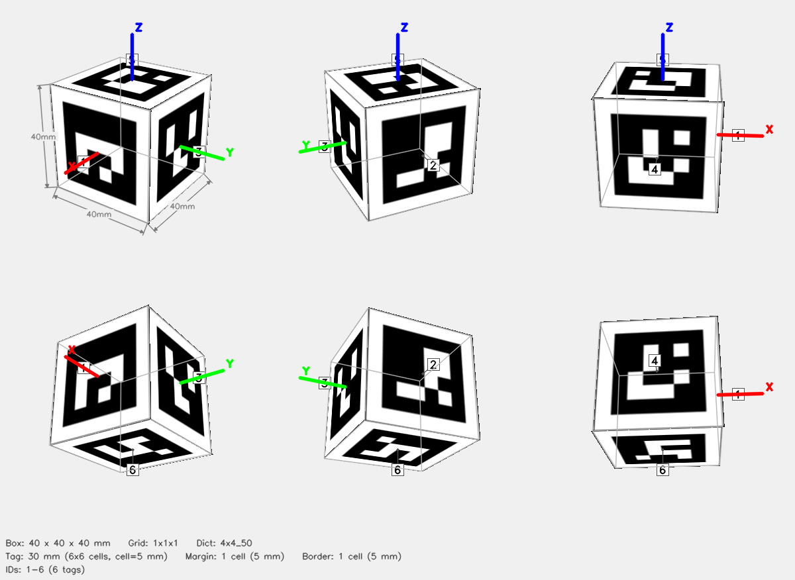
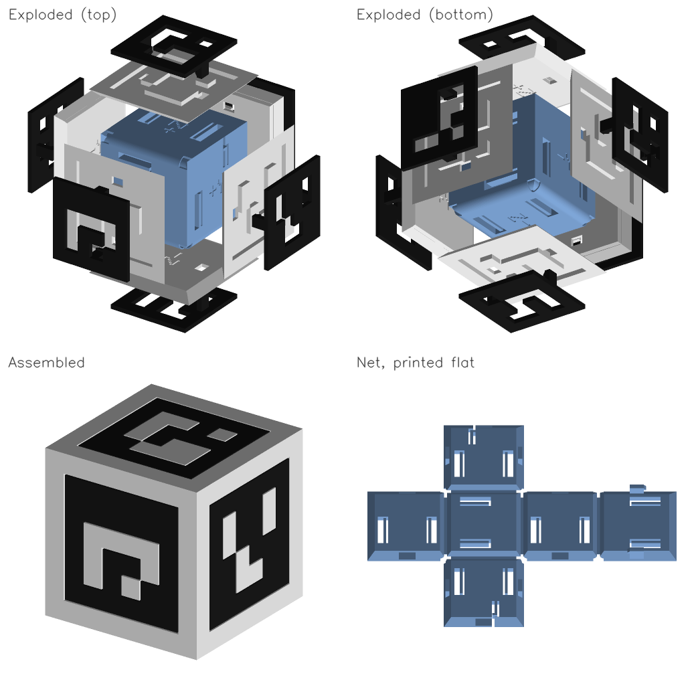

# ArUco Cube — 1x1x1



## Parameters

| Parameter | Value |
|-----------|-------|
| Dictionary | `4x4_50` |
| Grid | 1x1x1 (X x Y x Z tags) |
| Box dimensions | 40 x 40 x 40 mm |
| Tag size | 30 mm (6x6 cells) |
| Cell size | 5 mm |
| Margin | 1 cell (5 mm) |
| Border | 1 cell (5 mm) |
| Total tags | 6 |
| Tag IDs | 1–6 |


## Face Layout

| Face | Tag IDs |
|------|---------|
| +X | 1 |
| -X | 2 |
| +Y | 3 |
| -Y | 4 |
| +Z | 5 |
| -Z | 6 |

## Files

| File | Description |
|------|-------------|
| `print_black.3mf` | Six black lattices, print in black |
| `print_white.3mf` | Six white plates, print in white |
| `print_net.3mf` | Folding net, any color (hidden inside the cube) |
| `assembly_preview.3mf` | Assembled cube for inspection, not for printing |
| `mono_preview.png` | Exploded views, assembled cube, and flat net |
| `config.json` | Detector config (used by `detect_cube.py`) |
| `thumbnail.png` | 6-view preview |
| `mujoco/cube.xml` | MuJoCo MJCF model |
| `mujoco/cube.obj` | Wavefront OBJ mesh (UV-mapped) |
| `mujoco/cube.mtl` | OBJ material file |
| `mujoco/cube_atlas.png` | Texture atlas |

## Single-Color Printing

Each face is a black lattice (the marker's black pixels) pressed into a white
plate (everything else), mounted on a net that folds into the cube.



1. Print `print_black.3mf` in black and `print_white.3mf` in white. Both lie
   visible face down; a textured plate gives a matte, glare-free finish.
2. Print `print_net.3mf` in any color. PETG is the most forgiving at the
   thin hinge strips; with PLA, warm the hinges before folding.
3. Fold the net into a cube in this order: both `X` panels up, then both `Y`
   panels so their edge tabs slide into the slots in the `X` panels, then
   the `+Z` lid until its two tabs click into the `Y` panels. The latched
   net holds itself together. Each panel's outer face is labeled with its
   face name, for example `+X`.
4. For each face, set the white plate whose back carries the same label onto
   its panel, then press the black lattice into the plate until both legs
   click. A lattice only fits its own plate.

The barbs and the lid latches lock permanently. If the lattice is too tight
or too loose in its plate,
regenerate with `--mono-clearance` (current: 0.15 mm per side).

## Config JSON

```json
{
  "schema_version": 1,
  "target": {
    "type": "cuboid",
    "grid": "1x1x1"
  },
  "dict": "4x4_50",
  "grid": "1x1x1",
  "tag_ids": [
    1,
    2,
    3,
    4,
    5,
    6
  ],
  "faces": {
    "+X": [
      1
    ],
    "-X": [
      2
    ],
    "+Y": [
      3
    ],
    "-Y": [
      4
    ],
    "+Z": [
      5
    ],
    "-Z": [
      6
    ]
  },
  "tag_size_mm": 30.0,
  "cell_size_mm": 5.0,
  "margin_cells": 1,
  "border_cells": 1,
  "marker_pixels": 6,
  "box_dims": [
    40.0,
    40.0,
    40.0
  ],
  "mono": {
    "files": {
      "black": "print_black.3mf",
      "white": "print_white.3mf",
      "net": "print_net.3mf",
      "assembly": "assembly_preview.3mf",
      "preview": "mono_preview.png"
    },
    "inlay_mm": 1.6,
    "base_mm": 1.2,
    "panel_mm": 3.2,
    "fit_clearance_mm": 0.15,
    "slot_clearance_mm": 0.2,
    "hinge_mm": 0.4,
    "net_parents": {
      "+X": "-Z",
      "-X": "-Z",
      "+Y": "-Z",
      "-Y": "-Z",
      "+Z": "+X"
    },
    "edge_mm": 40.0,
    "tile_mm": 2.8,
    "panel_outer_mm": 34.4,
    "leg_offset_mm": 10.45
  }
}
```

## Regenerate

```bash
aprilcube generate --grid 1x1x1 --dict 4x4_50 --tag-size 30 --margin-cell 1 --border-cell 1 --mono -o mono_cube
```
