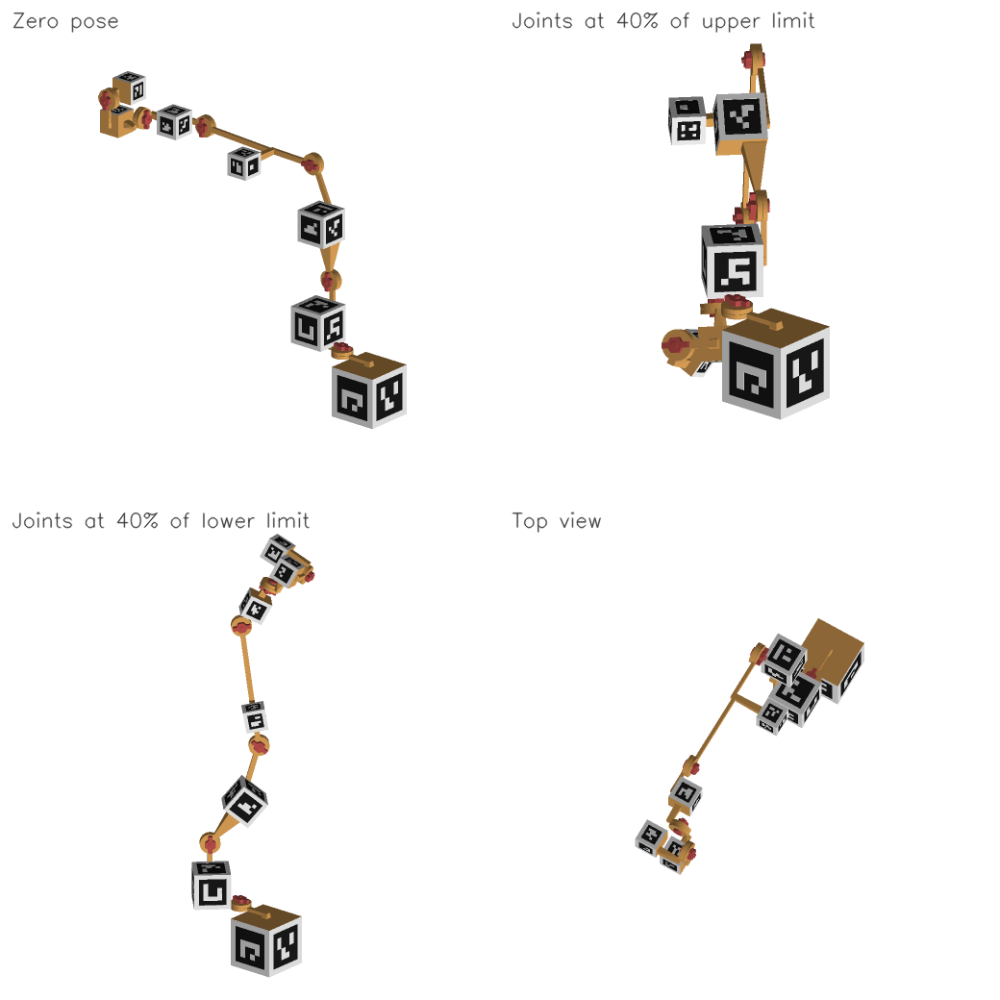

# Printed twin of `so101`

Every link of the robot is a marker cube, the largest that fits inside the
link's convex hull, joined to its neighbors by printed joints at the URDF joint
positions. A camera that tracks the cubes sees every link's pose, and from it
the joint angles. Scale: 1.5.

## Links

| Link | Cube | Markers (face tag) | Joint mounts |
|------|------|--------------------|--------------|
| `base` | 77.5 mm | +X 1, -X 2, +Y 3, -Y 4, -Z 5 | +Z |
| `shoulder` | 57.0 mm | +X 6, -X 7, +Y 10, -Z 11 | +Z, -Y |
| `upper_arm` | 49.0 mm | -X 13, +Y 14, -Y 15, +Z 16 | +X, -Z |
| `lower_arm` | 34.5 mm | +X 17, -X 18, +Y 20, -Y 21, +Z 22 | -Z |
| `wrist` | 36.4 mm | +X 23, -X 24, +Y 25, +Z 26 | -Y, -Z |
| `gripper` | 35.2 mm | +X 27, -X 28, -Y 29, -Z 30 | +Y, +Z |
| `jaw` | 34.5 mm | +X 31, -X 32, +Y 33, -Y 34, +Z 35 | -Z |

## Joints

| Joint | Type | Links | Hardware | Hard stops |
|-------|------|-------|----------|------------|
| `gripper` | revolute | `gripper` -> `jaw` | knuckle | -10 to 100 deg |
| `wrist_roll` | revolute | `wrist` -> `gripper` | knuckle | -160 to 160 deg |
| `wrist_flex` | revolute | `lower_arm` -> `wrist` | knuckle | -95 to 95 deg |
| `elbow_flex` | revolute | `upper_arm` -> `lower_arm` | knuckle | -100 to 90 deg |
| `shoulder_lift` | revolute | `shoulder` -> `upper_arm` | knuckle | -100 to 100 deg |
| `shoulder_pan` | revolute | `base` -> `shoulder` | knuckle | -110 to 110 deg |

## Printing

| File | What | Color |
|------|------|-------|
| `print_black.3mf` | Black lattices, one per marker | black |
| `print_white.3mf` | White plates, one per marker | white |
| `print_nets.3mf` | One folding net per link | any |
| `print_connectors.3mf` | Joint parts: mount plate, strut, and knuckle or slider | any, with supports |
| `print_hardware.3mf` | Bolts and wing nuts (and slider caps and pins) | any |

## Assembly

1. Fold each link's net into its cube (both `X` panels, then `Y`, then the
   `+Z` lid until it clicks) and fit its white plates and black lattices; each
   panel is engraved with the tag ID that goes on it.
2. Faces listed under *Joint mounts* take a connector instead of a marker:
   press the connector's legs into the panel until they click.
3. Revolute joints: stack the two knuckle discs so the stop pin sits in the
   groove, push the bolt through, and turn the wing nut until the joint holds
   its pose. The flat on the bolt keys it to the nut's disc, so moving the
   joint never loosens the nut.
4. Prismatic joints: slide the sleeve onto the bar, press the cap onto the free
   end, and push the pin through cap and bar.

## Tracking

`twin.json` describes the kinematic chain (joint origins in mm, axes, limits)
and each cube's pose in its link frame. `links/<link>/config.json` is a
standard aprilcube detector config whose marker corners are given in that
link's frame, so a detected pose is the link's pose.

## Checks

- link 'lower_arm': its hull only fits a 31.9 mm cube; using the 34.5 mm minimum, which sticks out up to 2.8 mm
- link 'jaw': its hull only fits a 26.9 mm cube; using the 34.5 mm minimum, which sticks out up to 8.4 mm
